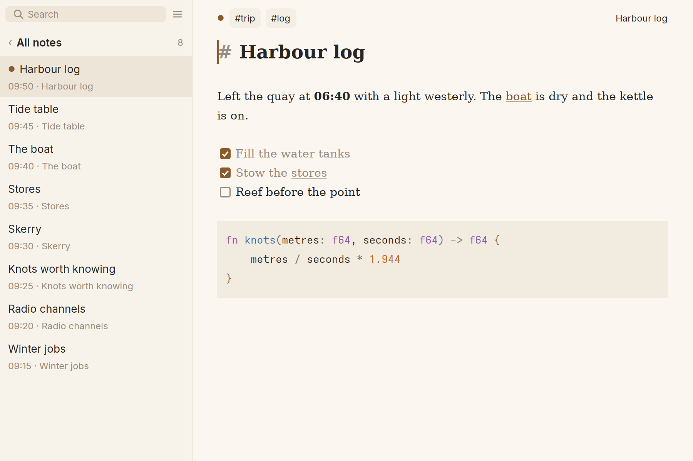

<p align="center">
  
</p>

<h1 align="center">Holm</h1>

<p align="center">
  A calm, keyboard-first desktop app for Markdown notes on Linux.
</p>

<p align="center">
  <picture>
    <source media="(prefers-color-scheme: dark)" srcset="docs/holm-dark.webp">
    
  </picture>
</p>

- **Your files.** Notes are plain `.md` files in one folder. Holm never goes online.
- **Live preview.** Markdown shows as styled text while you type. Its marks show only on the line with the cursor.
- **Keyboard first.** Every action has a key.
- **Linked notes.** Links, backlinks, tags, pins, search and quick open.
- **Early.** x86_64 Linux only, with no sync and no updater.

## Install

Each [release](https://github.com/mbezrukyi/holm/releases) has an AppImage and a `SHA256SUMS` file.

1. Download both and check the AppImage:

   ```sh
   gh release download --repo mbezrukyi/holm --pattern '*.AppImage' --pattern SHA256SUMS
   sha256sum -c SHA256SUMS
   ```

2. Open the AppImage with [Gear Lever](https://flathub.org/apps/it.mijorus.gearlever). It puts Holm in your app menu.

To update, do the same with the new release.

## Start

At the first start, Holm asks for your notes folder.

| Key | Action |
| --- | --- |
| `Ctrl+N` | New note |
| `Ctrl+Shift+O` | Open a note by its title |
| `Ctrl+?` | All shortcuts |

## Report a bug

Open an [issue](https://github.com/mbezrukyi/holm/issues). Write what you did, what you expected, and what happened, and attach the log, `~/.local/state/holm/holm.log`. The log holds paths and note ids, never note text.

For more detail, start Holm with `HOLM_LOG=debug holm` and do the steps again.

---

Holm takes issues, not pull requests.

Holm is written with Claude, an AI model by Anthropic. Its author decides what Holm does and directs the work.
